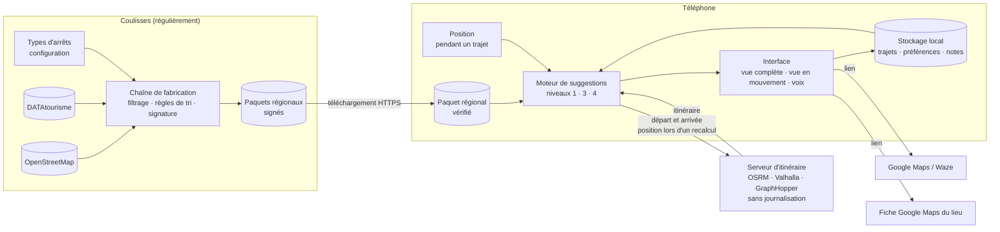

# Architecture

Le principe : **le téléphone fait presque tout**. Les lieux y sont stockés, les suggestions y sont calculées, la position n'en sort que dans les cas listés ci-dessous. Les serveurs se limitent à distribuer des paquets et à calculer des itinéraires.

## Flâne seule

## Ce qui sort du téléphone

| Vers | Quoi | Quand |
| --- | --- | --- |
| Serveur de paquets | La région demandée (et, techniquement, l'adresse IP) | Au téléchargement d'une région |
| Serveur d'itinéraire | Départ et arrivée ; la position courante lors d'un recalcul (et l'adresse IP) | À la planification, ou au recalcul après un détour |
| Google Maps / Waze | La destination ou les étapes, par lien | Quand l'utilisateur appuie sur « On y va » ou envoie son trajet |

## À l'étape 2

Supabase (Postgres et PostGIS) s'ajoute pour les avis et les trajets partagés. Les avis enrichissent les paquets (palier 1). Les trajets partagés passent par des actions (`TripAction`) envoyées d'un téléphone à l'autre.
