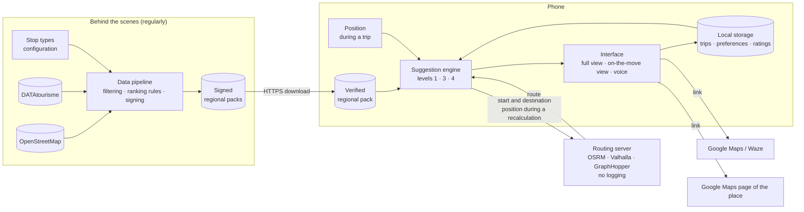

# Architecture

The principle: **the phone does almost everything**. Places are stored on it, suggestions are computed on it, and the position only leaves it in the cases listed below. Servers are limited to distributing packs and computing routes.

## Flâne alone

## What leaves the phone

| To | What | When |
| --- | --- | --- |
| Pack server | The requested region (and, technically, the IP address) | When a region is downloaded |
| Routing server | Start and destination; the current position during a recalculation (and the IP address) | When planning, or when recalculating after a detour |
| Google Maps / Waze | The destination or the waypoints, by link | When the user taps « On y va » or sends their trip |

## At stage 2

Supabase (Postgres and PostGIS) is added for reviews and shared trips. Reviews enrich the packs (tier 1). Shared trips go through actions (`TripAction`) sent from one phone to the other.
